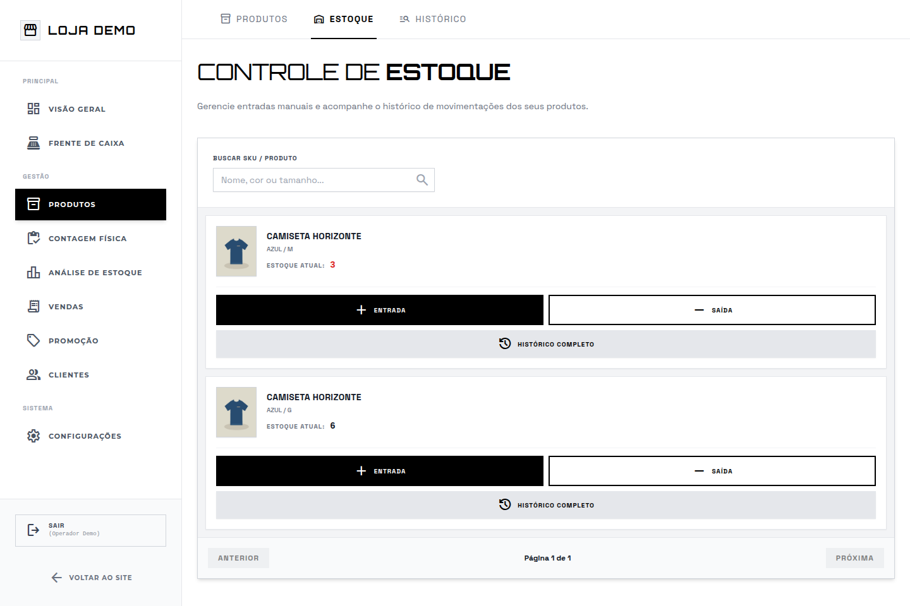

# RBX Commerce — Technical Report

[Português](https://github.com/ZKSCode/RBX-Commerce-Relatorio-Tecnico)

**Inventory, product, and sales management for retail.**

RBX Commerce tracks stock by product variant. Staff can register products, record stock movements, compare the recorded balance with a physical count, and trace each variant's movements after a sale. At the counter, the cashier finds the exact variant by barcode and completes the sale at the point of sale (POS).

| Role | What the system supports |
|---|---|
| Cashier | Barcode or text search, sales, receipts, register opening, cash deposits, cash withdrawals, and closing. |
| Administrator | Product registration and import, stock movement history, and sales reporting. |

## Technical highlights

- **Inventory control.** Stock movements record a quantity and a reason. Physical counts reveal discrepancies that staff can investigate using the movement history.
- **Cash reconciliation.** The opening amount and subsequent cash movements determine the expected balance. Closing records the difference between the cash counted and the cash expected.
- **Sales by variant.** Color, size, EAN barcode, and available stock identify the exact item. The POS records the sale and its related movements in a database transaction.

The project uses PHP and Laravel, Eloquent and Blade, Alpine.js, Tailwind CSS, and Vite. The POS can generate a Pix payment code.

- [Annotated screenshot gallery](docs/gallery.md)
- [Case study from variant setup to register closing](docs/case-study.md)
- [Technical report and verification scope](docs/technical-report.md)
- [Interface design and workflows](docs/design.md)
- [Demonstrations and test results](docs/demonstrations.md)
- [Résumé bullets and interview summary](docs/resume.md)

The screenshots show the original Portuguese interface with fictional demo data. English captions explain each screen. The source excerpts are proprietary to ZKSCode.

[Copyright notice](LICENSE.md)
