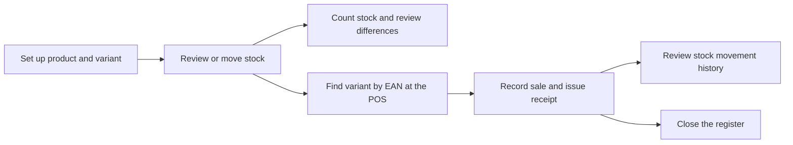

# Interface design and workflows

[Português](https://github.com/ZKSCode/RBX-Commerce-Relatorio-Tecnico/blob/main/docs/design.md) · [Technical report home](../README.md)

The inventory interface organizes work by variant. The POS divides the sale into items, customer identification, and payment. Both surfaces keep the figures staff need to verify close to the actions that update them.

| Surface | Observed behavior |
|---|---|
| Product setup | The variants section groups price, stock, minimum stock, and EAN. Categories and subcategories organize the product list. |
| Inventory controls | Each variant displays its balance and offers actions for stock in, stock out, and movement history. The movement form asks for a quantity and a reason. |
| Physical count | The screen places the recorded and counted quantities side by side, highlights differences, and shows how many variants will be adjusted. |
| CSV import | The preview flags existing products before staff confirm the import. |
| POS | EAN search, line items, keyboard shortcuts, and the sale total remain visible throughout the counter sale. |
| Register closing | The closing dialog separates expected and counted cash. The history records the discrepancy for review. |

## Operational workflow

The [annotated gallery](gallery.md) shows these steps with fictional data and artwork. The [validation notes](demonstrations.md) describe the demo environment and the states reproduced there.
