# Annotated RBX Commerce gallery

[Português](https://github.com/ZKSCode/RBX-Commerce-Relatorio-Tecnico/blob/main/docs/galeria.md) · [Technical report home](../README.md)

The screenshots show the original Portuguese interface with fictional data. The same demo product, **Camiseta Horizonte**, costs BRL 40. Follow it from variant setup and inventory control to a counter sale and the administrative records it creates.

## 1. Products and inventory

**Variant setup.** The editor groups color, size, price, stock, minimum stock, and EAN. The M and G size labels in the screenshot represent medium and large. Each size has its own balance.

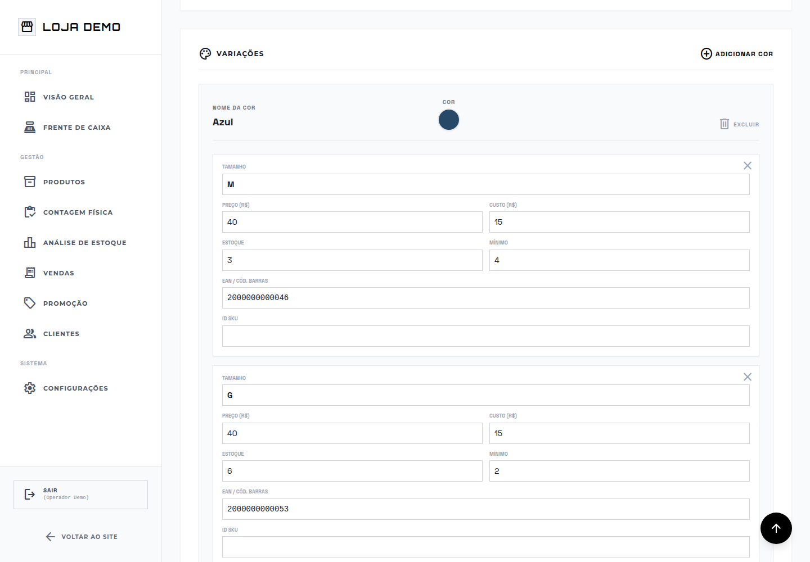

**Manual stock intake.** Staff choose a variant and enter a quantity and a reason. The screenshot shows a proposed replenishment of two units before saving.

[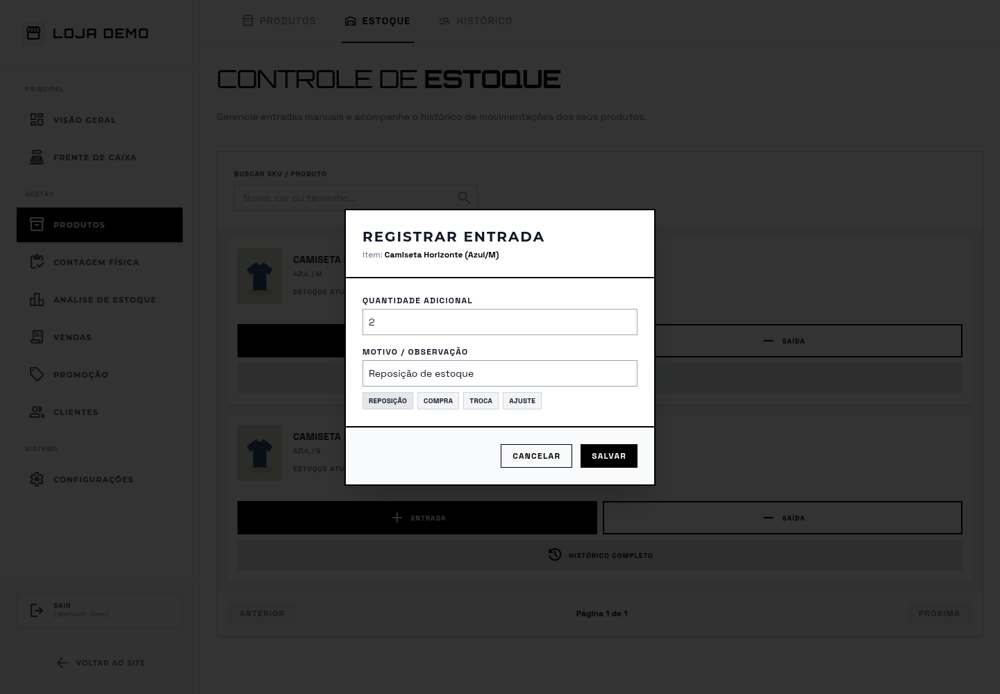](../media/estoque-entrada-manual.png)

**Physical count.** The system shows three units of size M. Entering a count of two and selecting damage as the reason produces a discrepancy of −1. The screen shows the pending adjustment.

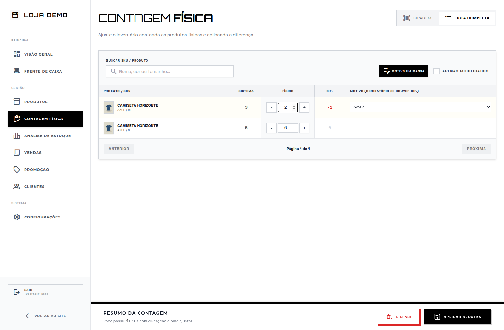

**Current stock and history.** The stock screen shows the balance by variant. The movement history shows two sales that reduced the balance from five to four and then to three.

| Stock by variant | Movement history |
|---|---|
| [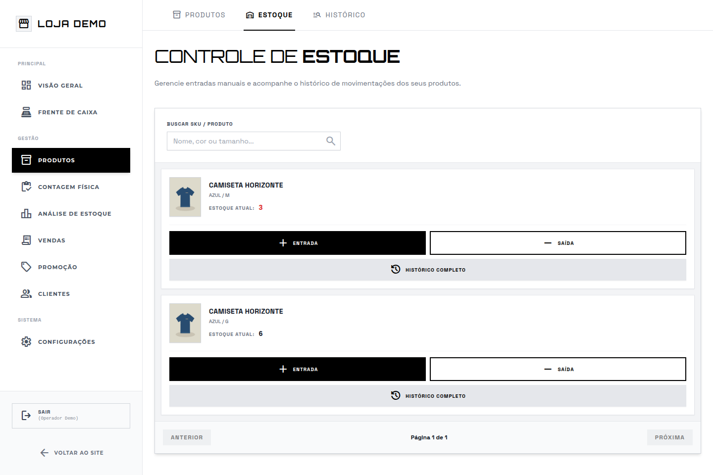](../media/estoque-posicao.png) | [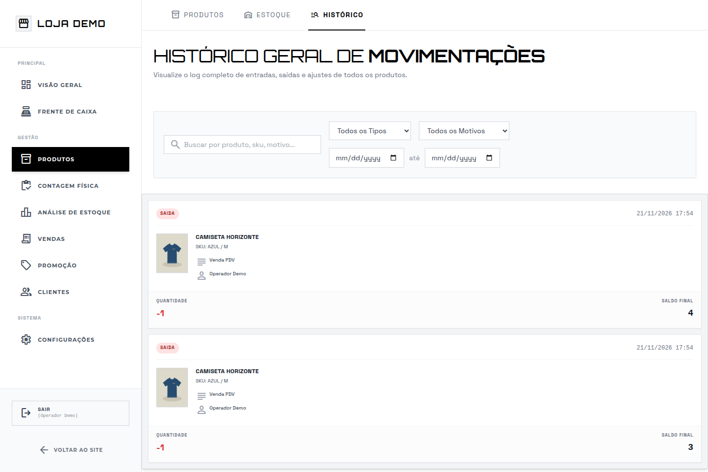](../media/estoque-historico.png) |

**Bulk operations.** The categories dialog shows Apparel and T-shirts. The CSV preview flagged an existing product after the demo store's own export was submitted for review. The screenshot captures the preview step before confirmation.

| Product categories | CSV import preview |
|---|---|
| [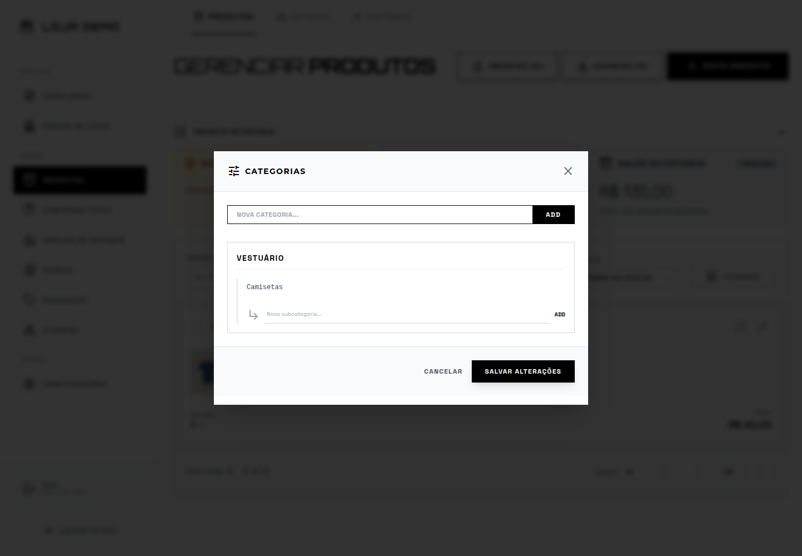](../media/gestao-categorias.png) | [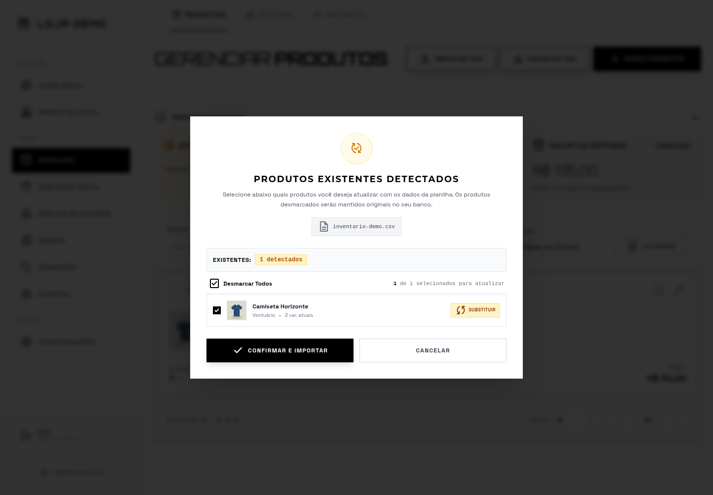](../media/gestao-importacao-csv.png) |

## 2. From barcode scan to receipt

**Open register.** Looking up the EAN adds the exact variant to the demo sale. Line items appear on the left, customer identification in the middle, and payment options on the right. The register balance appears above the sale.

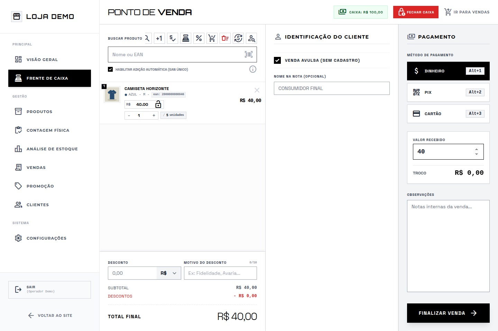

**Receipt.** After the cash sale, the system displays the item, quantity, BRL 40 total, amount received, and change. The header identifies the document as a non-fiscal receipt.

[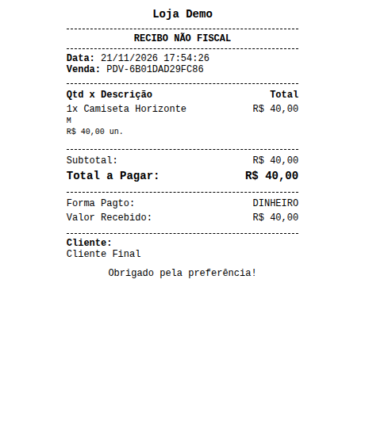](../media/pdv-recibo.png)

## 3. From counting cash to closing

**Reconciliation.** The session started with BRL 100. A cash sale added BRL 40, a deposit added BRL 10, and a withdrawal removed BRL 20. Expected cash was BRL 130. The cashier entered BRL 128 before confirming the close.

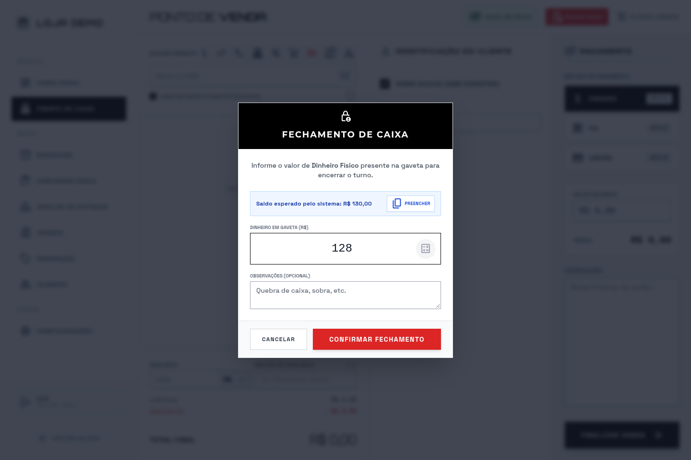

**Recorded result.** The history shows a BRL 2 shortage. The printed summary breaks down the cash movements from the BRL 100 opening amount to the BRL 130 expected balance.

| Register history | Printed closing summary |
|---|---|
| [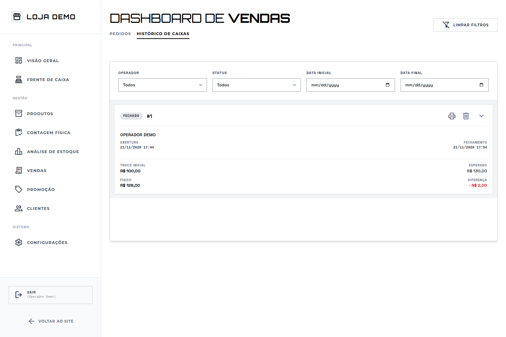](../media/caixa-historico.png) | [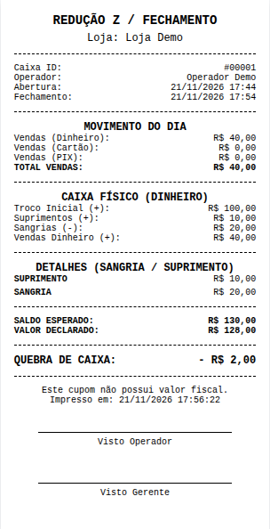](../media/caixa-resumo.png) |

## 4. What management sees after the sale

**Products.** The same T-shirt appears in the administrative product list. Above the list, metrics show low stock and inventory value. This screen also groups product creation, import, and export.

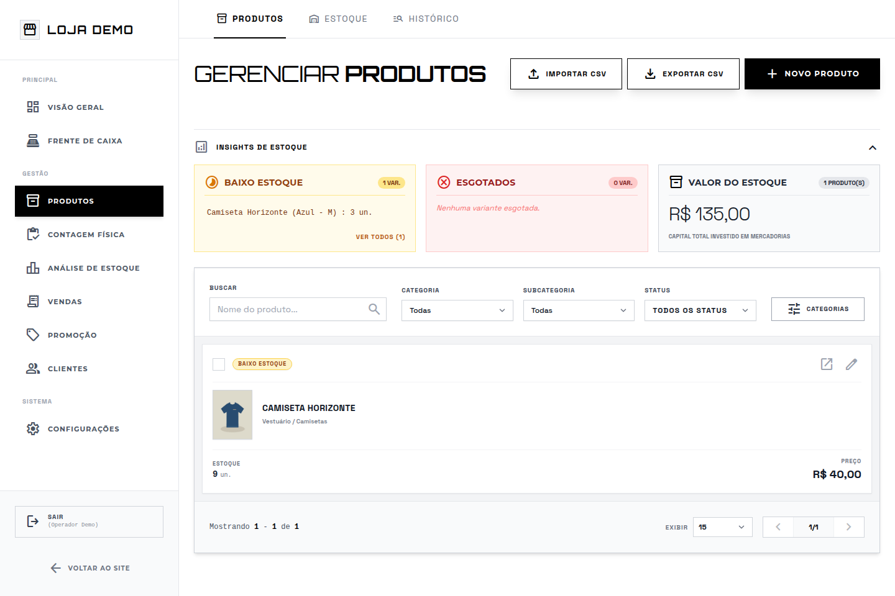

**Sales.** The dashboard shows BRL 80 from the two BRL 40 sales. The [printed summary](../media/caixa-resumo.png) shows BRL 40 total. It groups card payments classified as debit or credit, while the POS saved the second payment under the generic card value. The issue affects the sales total on the printed summary. Expected physical cash remains BRL 130, and the shortage remains BRL 2.

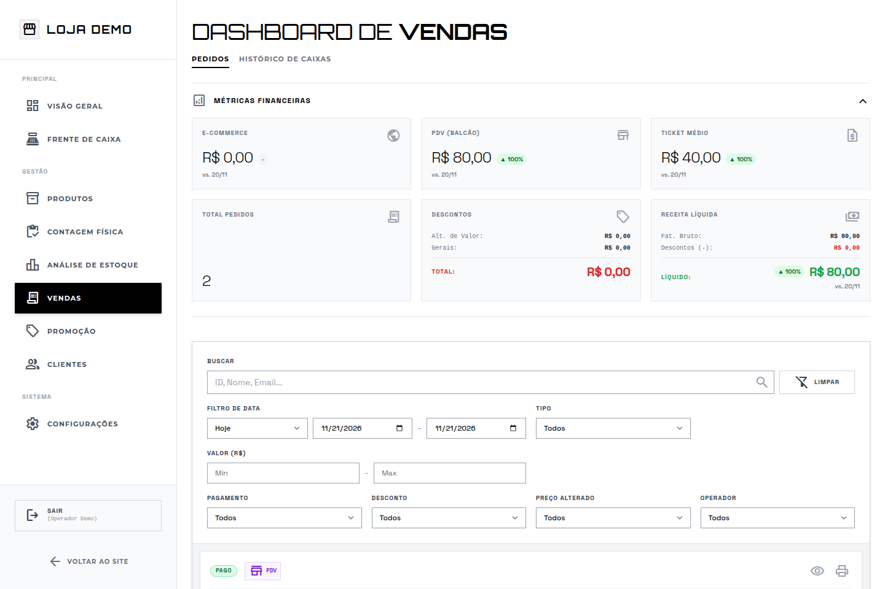

The [case study](case-study.md) connects these screens to the business rules. The [validation notes](demonstrations.md) document the environment and test results.
