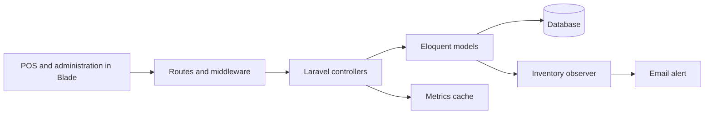
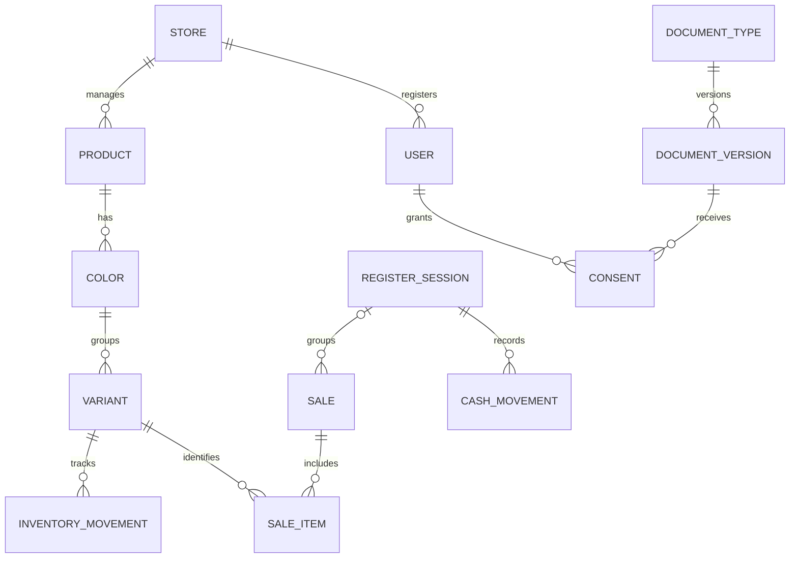

# Technical report

[Português](https://github.com/ZKSCode/RBX-Commerce-Relatorio-Tecnico/blob/main/docs/relatorio-tecnico.md) · [Technical report home](../README.md)

## Scope and stack

The review used commit `391bc9fca8d1` from the `main` branch on November 21, 2026. The source inventory contains 105 HTTP route declarations, 31 files in the controllers directory, 98 Blade templates, and 60 migrations. It also includes Artisan commands, configuration, dependency manifests and lockfiles, and automated tests.

| Layer | Implementation |
|---|---|
| Application | PHP requirement `^8.2`, Laravel 11.44.7, controllers, middleware, services, and Blade components. |
| Data | Eloquent, migrations, indexes, foreign keys, store-level scoping in operational models, and stock movement records. The configuration includes SQLite and MySQL connections. |
| Interface | Blade rendering, Tailwind CSS 3.4.19, Alpine.js 3.15.9, Chart.js 4.5.1, and Vite 6.4.2. |
| Services | Pix payment code generation at the POS, email, and caching. The lockfile includes Laravel Pulse 1.8.0. |
| Testing | PHPUnit 11.5.18, example tests, and cases for login with pending consent, accepting terms, and signing in after consent. |

## Architecture and data





The data diagram is conceptual. A sale may link to a register session. Color and size belong to distinct entities. Each sale item references the variant and records details from the transaction. Stock movements retain balances before and after the change. Register sessions store opening, counted and expected cash, and the closing discrepancy. Legal documents track versions and associate consent with each user.

## Functional coverage

| Area | Workflow | Rules and verification notes |
|---|---|---|
| Consent | Publish document versions → request consent during login → accept → continue. | Recording the accepted version distinguishes new terms from historical consent. RBX Lite checks for pending consent before login completes. |
| POS | Open register → find a product or customer → process the sale → issue a receipt. | Numeric search prioritizes an exact EAN match. Promotions can target the POS. Discounts and price overrides have approval flows. Pix code generation is implemented. The status lookup route remains pending in the reviewed revision. |
| Cash drawer | Opening balance → sales and cash movements → closing → history and printing. | Cash sales and deposits increase the expected cash balance. Withdrawals reduce it. The discrepancy equals counted cash minus expected cash. |
| Products and categories | Create or edit → check name and EAN → attach variants and images. | The system includes CSV preview, import and export, bulk deletion, and barcode labels. |
| Inventory | Record a movement or count stock → update the variant → review current balances and history. | Some adjustment paths use row-level locking. The observer checks outgoing stock from sales and transitions to minimum or zero stock. |
| Customers, sales, and metrics | Administration → customers and sales → register history → overview and statistics. | Inventory metrics can be invalidated by store. Latency and adoption require separate measurement. |
| Configuration | Payments, notifications, users, POS, tax settings, and promotions. | Promotions have dates, targets, and channels. The review confirmed the tax settings interface. Fiscal document issuance remains outside the verification scope. |
| Stores and RBX Lite | Provision a store → assign a user and role → scope operations. | RBX Lite controls access to administrative areas. Eloquent scoping depends on an authenticated user assigned to a store. Coverage must be checked for each report and service. |

## Implementation decisions

**POS transaction.** The controller locks the variant row inside a database transaction and applies sale rules before updating stock. Related records are written in the same operation. Concurrent-session behavior requires testing on a database with compatible locking semantics.

**Store-level scoping.** Some operational models use a trait that registers a global Eloquent scope and populates the store identifier when creating records in the relevant authentication context.

```php
static::addGlobalScope(new TenantScope);
```

**Maintenance.** Recent changes covered consent, cache invalidation, and consistent timestamps for sales and receipts. A load-test seeder targets 2,000 synthetic products. That target describes the fixture size.

The [validation notes](demonstrations.md) cover the build, migrations, tests, and limits of the runtime checks.
